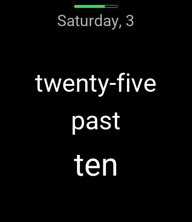
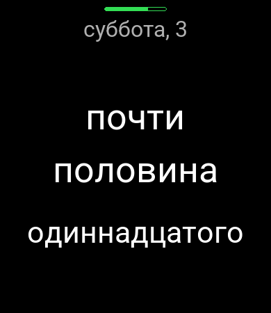

# zepp-watchface-inaccurate

"Inaccurate time": a Zepp OS text watch face for 390×450 Amazfit watches that
shows the time in words, rounded down to 5 minutes, in English or Russian.

 

## Features

- Time in words on three centered lines, the hour largest; the layout never jumps when a line is empty
- English ("quarter past / ten", "twenty-five / to / eleven") or Russian ("четверть / одиннадцатого", "без пяти / час"),
  following the watch language: Russian on a Russian watch, English for every other language
- Date line at the top: weekday and day of month
- Thin battery line at the top edge, red below 20 %
- Always-on display: the same date and time text in dimmed gray, no battery line
- No permissions, no network requests, no data collected

## Supported devices

| Device | API level |
|---|---|
| Amazfit Bip 6 | 4.2 |
| Amazfit Active 2 (Square) | 4.2 |
| Amazfit Active | 3.6 |
| Amazfit Cheetah (Square) | 3.7 |
| Amazfit GTS 4 | 3.5 |

All share the 390×450 screen; they are platforms of one target in `app.json`.
The face needs API level 2.1, so 390×450 devices on Zepp OS 1.0 (GTS 3) are not supported.

## Development

Requires [Zeus CLI](https://docs.zepp.com/docs/guides/tools/cli/) and Node.js.

```sh
zeus dev                               # run in the Zepp OS Simulator
zeus preview                           # QR code to install on a watch (Zepp app → Developer Mode)
zeus build -t 390x450-amazfit-bip-6    # package for the store, written to dist/
node --test test/                      # unit tests: phrases for every minute in both languages
```

Previews (`tools/preview-*.png` and the watch's `assets/…/icon.png`) are rendered by
`tools/render_preview.py` (needs Pillow and Node). It mirrors the layout in
`watchface/index.js`, so keep the two in sync when changing positions or sizes.

| Path | What it is |
|---|---|
| `watchface/index.js` | Watch face: text widgets for normal and AOD, battery bar, minute and battery updates |
| `utils/fuzzy.js` | Pure logic: phrases per language, weekday names, text sizing, battery helpers |
| `test/` | Node tests |
| `tools/render_preview.py`, `tools/sample_texts.mjs` | Preview renderer |

## Adding a language

Add a phrase table to `PHRASES` and weekday names to `WEEKDAYS` in `utils/fuzzy.js`,
then map the watch's language code to it in `watchface/index.js`
([language codes](https://docs.zepp.com/docs/v2/reference/related-resources/language-list/)).

## Font

The previews are rendered with [Roboto](https://github.com/googlefonts/roboto-classic),
licensed under the SIL Open Font License 1.1 (`tools/fonts/OFL.txt`). The watch itself
uses its system font.
